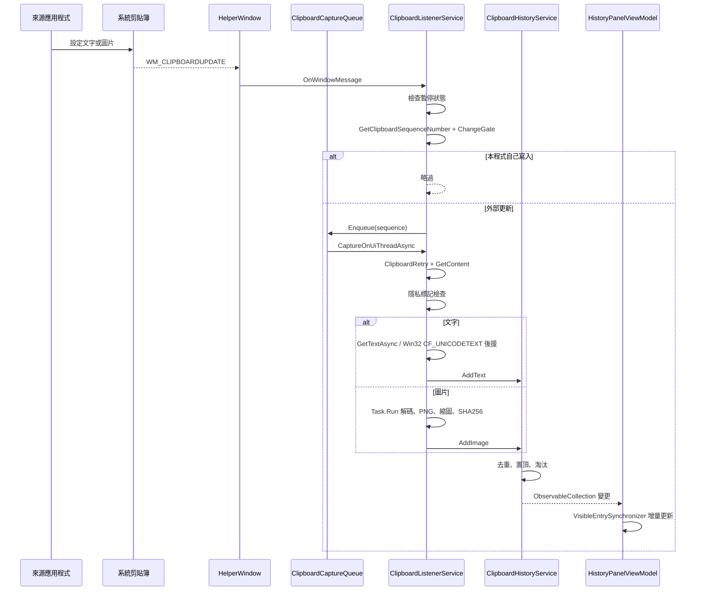

# 系統架構與技術文件

本文件描述 SaveClipboard 的技術架構、模組職責、執行緒模型、資料流與系統整合方式。閱讀前建議先看 [系統設計文件](DESIGN.md) 了解產品需求與行為。

## 1. 技術總覽

| 項目 | 選擇 | 說明 |
| --- | --- | --- |
| 語言 | C# | nullable reference types、file-scoped namespace |
| 執行環境 | .NET 10 | TFM `net10.0-windows10.0.19041.0` |
| 最低系統 | Windows 10 1809（10.0.17763） | 受 Windows App SDK 支援範圍限制 |
| UI | WinUI 3（Windows App SDK 1.8） | 未封裝（unpackaged）模式 |
| MVVM | CommunityToolkit.Mvvm 8.4.2 | `ObservableObject`、`RelayCommand` |
| DI／生命週期 | Microsoft.Extensions.Hosting 10 | `HostApplicationBuilder` |
| 日誌 | Microsoft.Extensions.Logging | 自訂檔案 Provider + Debug Provider |
| 加密保存 | System.Security.Cryptography.ProtectedData | Windows DPAPI，`CurrentUser` |
| 測試 | xUnit 2.9.3 + Microsoft.NET.Test.Sdk | `tests/SaveClipboard.Tests` |
| 套件管理 | Central Package Management | 版本集中於 `Directory.Packages.props` |

## 2. 執行模型

SaveClipboard 是單一處理序的常駐桌面程式，沒有傳統主視窗。執行時包含：

1. **WinUI 面板視窗**（`HistoryPanelWindow`）：使用者看到的彈出面板，同時承載設定頁。
2. **隱藏輔助視窗**（`HelperWindow`）：1×1 原生視窗，接收剪貼簿、全域快捷鍵、系統匣與第二實例訊息。
3. **系統匣圖示**：以 `Shell_NotifyIcon` 建立，不依賴 WinForms。
4. **背景工作**：剪貼簿擷取佇列、圖片解碼、DPAPI 保存與日誌寫入。

```text
┌───────────────────────────── SaveClipboard.exe ─────────────────────────────┐
│                                                                              │
│  ┌──────────────┐   訊息    ┌────────────────────┐   事件   ┌─────────────┐  │
│  │ Explorer /   │──────────▶│ HelperWindow        │─────────▶│ 服務層       │  │
│  │ 其他 App      │ WM_*      │ (隱藏原生視窗)       │          │             │  │
│  └──────────────┘           └────────────────────┘          │ Clipboard   │  │
│         ▲                          ▲                        │ Listener    │  │
│         │ 寫入剪貼簿                 │ Shell_NotifyIcon       │ TrayIcon    │  │
│         │                          │ RegisterHotKey         │ Hotkey      │  │
│  ┌──────┴───────┐           ┌──────┴───────┐                │ ...         │  │
│  │ 系統剪貼簿     │◀──────────│ 寫入剪貼簿     │                └──────┬──────┘  │
│  └──────────────┘           └──────────────┘                       │         │
│                                     ▲                              │         │
│                                     │ Binding／Command              │         │
│                              ┌──────┴──────────────────────────────▼──────┐  │
│                              │ HistoryPanelWindow + ViewModels            │  │
│                              │ （WinUI 3，UI 執行緒）                      │  │
│                              └────────────────────────────────────────────┘  │
└──────────────────────────────────────────────────────────────────────────────┘
```

### 程序啟動順序

1. `App` 建構子註冊 `AppDomain.UnhandledException`、`TaskScheduler.UnobservedTaskException` 與 WinUI `UnhandledException`。
2. `OnLaunched` 建立具名 Mutex `Local\SaveClipboard.SingleInstance`。
   - 若已存在實例：等待既有 `HelperWindow`，送出 `WM_SHOW_PANEL`，同步等待最多 3 秒後結束。
   - 若為第一個實例：建立 `AppLifetime`、Host、服務與視窗。
3. 建立 `HostApplicationBuilder`，註冊服務與 `AppSettings` 單例。
4. 讀取設定；若啟用加密保存，載入 `history.dat`。
5. 建立 `HelperWindow`、`HotkeyService`、`TrayIconService`。
6. 建立 `ClipboardWriterService`、`HistoryPanelViewModel`、`HistoryPanelWindow`、`ClipboardListenerService`。
7. 依啟動方式顯示或隱藏面板：
   - 手動啟動：`ShowNearTray()`。
   - `--autostart`：`StartHidden()`，只常駐系統匣。

### 結束順序

`ExitApplication()` 會依序：

1. 取消 `AppLifetime` token，停止背景流程。
2. `PrepareForExit()` 關閉對話框與計時器。
3. `PersistBounds()` 保存面板位置與大小。
4. 解除事件訂閱。
5. `Flush()` 並 `Dispose()` 歷史保存協調器。
6. 釋放系統匣、快捷鍵、剪貼簿監聽、輔助視窗、Host 與 lifetime。
7. `Application.Current.Exit()`。

## 3. 專案結構與命名空間

```text
src/SaveClipboard/
  App.xaml / App.xaml.cs          應用程式入口、DI、生命週期
  SaveClipboard.csproj            WinUI 3 專案設定
  app.manifest                    PerMonitorV2 DPI、long path
  Assets/                         AppIcon.ico、AppIcon-256.png
  Views/
    HistoryPanelWindow.xaml(.cs)  面板與設定頁
  ViewModels/
    HistoryPanelViewModel.cs      歷史清單、搜尋、選取、暫停、複製
    SettingsViewModel.cs          設定草稿、儲存、重設
    ThemeSwatchViewModel.cs       主題色 swatch
  Models/
    AppSettings.cs                使用者設定與正規化
    ClipboardEntry.cs             歷史項目
    ClipboardEntryKind.cs         Text／Image
    ClipboardSkipReason.cs        隱私略過原因
    DeletedClipboardEntry.cs      刪除復原資料
    DisplayMode.cs                System／Light／Dark
    SettingsLoadStatus.cs         Ok／Missing／Recovered／Unavailable
    ThemeCatalog.cs               10 款主題
    ThemeOption.cs                主題定義
  Services/
    AppLifetime.cs                應用程式層級 CancellationTokenSource
    ClipboardCaptureQueue.cs      剪貼簿更新 FIFO 佇列與逾時
    ClipboardChangeGate.cs        以剪貼簿序號抑制自我更新
    ClipboardHistoryService.cs    歷史集合、去重、釘選、淘汰
    ClipboardListenerService.cs   剪貼簿監聽與文字／圖片擷取
    ClipboardPrivacyPolicy.cs     隱私標記決策
    ClipboardRecordingState.cs    暫停記錄狀態
    ClipboardSearchFilter.cs      搜尋過濾純函式
    ClipboardWriterService.cs     寫入剪貼簿與結果狀態
    DiagnosticsFileLoggerProvider.cs  檔案日誌與輪替
    DialogService.cs              ContentDialog 單一實例防護
    HistoryPersistenceCoordinator.cs  歷史保存排程
    HistoryPersistenceService.cs  DPAPI 加解密
    HotkeyService.cs              Ctrl+Alt+V
    SettingsService.cs            設定檔讀寫與損毀復原
    StartupService.cs             HKCU Run 機碼
    ThemeService.cs               顯示模式與主題筆刷
    TrayIconService.cs            系統匣圖示、選單、氣泡
    VisibleEntrySynchronizer.cs   可見清單增量同步
    WindowPlacementService.cs     面板位置、DPI、工作區夾限
  Helpers/
    AppStrings.cs                 資源字串存取
    BoolToOpacityConverter.cs
    BoolToVisibilityConverter.cs
    BytesToImageSourceConverter.cs
    ClipboardFormatReader.cs      Win32 CF_UNICODETEXT 與隱私標記讀取
    ClipboardRetry.cs             剪貼簿忙碌重試
    DateTimeFormatConverter.cs
    DiagnosticLog.cs              崩潰日誌
    HelperWindow.cs               隱藏訊息視窗
    ImageKindToVisibilityConverter.cs
    NativeMethods.cs              P/Invoke 與常數
    TextKindToVisibilityConverter.cs
  Styles/
    TextStyles.xaml               共用文字樣式
    Themes/CommonBrushes.xaml     主題筆刷資源
  Strings/
    zh-Hant/Resources.resw
    en-US/Resources.resw
```

命名空間根為 `Com.VibeCoding.SaveClipboard`，組件名稱為 `SaveClipboard`。

## 4. 依賴注入與服務註冊

`App.OnLaunched` 以 `Host.CreateApplicationBuilder()` 建立容器，主要註冊如下：

| 服務 | 生命週期 | 說明 |
| --- | --- | --- |
| `SettingsService` | Singleton | 設定檔路徑與讀寫 |
| `StartupService` | Singleton | HKCU Run 機碼 |
| `HistoryPersistenceService` | Singleton | DPAPI 歷史檔 |
| `ThemeService` | Singleton | 顯示模式與主題筆刷 |
| `ClipboardChangeGate` | Singleton | 自我更新抑制 |
| `ClipboardRecordingState` | Singleton | 暫停狀態 |
| `AppSettings` | Singleton | 由 `SettingsService.Load()` 建立 |
| `ClipboardHistoryService` | Singleton | 以 `AppSettings.MaxItems` 建立 |
| `ILoggerFactory` | Singleton | Host 內建 |

部分服務由 `App` 直接建立，因為需要原生視窗或 UI 執行緒相依：

- `HelperWindow`
- `HotkeyService`
- `TrayIconService`
- `ClipboardWriterService`
- `ClipboardListenerService`
- `HistoryPersistenceCoordinator`
- `HistoryPanelWindow`

日誌設定：

- 最低等級 `Debug`。
- `Microsoft.*` 限制在 `Warning` 以上。
- Debug 建置額外使用 `AddDebug()`。
- 檔案 Provider 寫入 `%LOCALAPPDATA%\SaveClipboard\Logs\app.log`，1 MB 輪替為 `app.log.1`。

## 5. 剪貼簿擷取管線



### 5.1 訊息接收

`ClipboardListenerService` 建構時呼叫 `AddClipboardFormatListener(_window.Handle)`，並訂閱 `HelperWindow.MessageReceived`。收到 `WM_CLIPBOARDUPDATE` 後：

1. 若 `ClipboardRecordingState.IsPaused`，直接略過。
2. 讀取 `GetClipboardSequenceNumber()`。
3. `ClipboardChangeGate.TryConsume(sequence)` 若落在本程式寫入前後的序號範圍內，代表是自我更新造成的內容，略過。
4. 將序號加入 `ClipboardCaptureQueue`。

### 5.2 擷取佇列

`ClipboardCaptureQueue` 以 FIFO 處理序號：

- 一次只處理一筆，避免並行讀取剪貼簿造成競態。
- 待處理超過 8 筆時丟棄最舊序號並記錄 `DroppedCount`。
- 每筆擷取有 15 秒逾時；逾時後放行並處理下一筆，避免來源程式無回應導致永久停擺。
- 所有擷取流程最終回到 UI 執行緒，因為 `Clipboard` API 與 `ObservableCollection` 需在 UI 執行緒存取。

### 5.3 格式與隱私判定

擷取順序：

1. `Clipboard.GetContent()`（含重試）。
2. 讀取 `AvailableFormats`。
3. 若含 `ExcludeClipboardContentFromMonitorProcessing`，略過。
4. 若含 `CanIncludeInClipboardHistory`，以 Win32 讀取 DWORD，值為 0 時略過。
5. 若格式清單無法取得，改用 Win32 檢查隱私標記，再嘗試 `CF_UNICODETEXT`。
6. 優先處理文字；沒有文字才處理圖片。
7. 若 WinRT 回報沒有支援格式，最後再嘗試 Win32 文字後援。

Win32 後援由 `ClipboardFormatReader.TryReadUnicodeText` 實作，於背景執行緒開啟剪貼簿、讀取 `CF_UNICODETEXT`、複製字串後關閉。

### 5.4 文字

- `ClipboardRetry.RunAsync` 最多重試 3 次，間隔 40／80 ms。
- 空白或全空白文字略過。
- 超過 2,097,152 字元（200 萬字元）略過並記錄警告。
- 文字鍵值為 `"T:" + SHA256(UTF8(text))`，不把完整文字放進鍵值。

### 5.5 圖片

1. 取得 `RandomAccessStreamReference` 並讀出原始位元組。
2. 在 `Task.Run` 中：
   - 以 `BitmapDecoder` 解碼。
   - 重新編碼為 PNG。
   - 以原始位元組建立最大寬度 96 px 的縮圖 PNG。
   - 對 PNG 計算 SHA256 作為像素雜湊。
3. 回到 UI 執行緒呼叫 `AddImage`。

圖片鍵值為 `"I:" + hex(pixelHash)`。

## 6. 歷史資料模型與淘汰策略

### 6.1 `ClipboardEntry`

| 欄位 | 型別 | 說明 |
| --- | --- | --- |
| `Id` | `Guid` | 項目識別碼 |
| `Kind` | `ClipboardEntryKind` | Text／Image |
| `Text` | `string?` | 文字內容 |
| `ImageBytes` | `byte[]?` | PNG 位元組 |
| `ThumbnailBytes` | `byte[]?` | 縮圖 PNG |
| `ImagePixelHash` | `byte[]?` | 圖片像素雜湊 |
| `Key` | `string` | 去重鍵值 |
| `CopiedAt` | `DateTimeOffset` | 複製時間 |
| `IsPinned` | `bool` | 是否釘選 |
| `IsSelected` | `bool` | UI 勾選狀態 |
| `Preview` | `string` | 延遲計算的預覽文字 |

`ClipboardEntry` 實作 `INotifyPropertyChanged`，供釘選、選取與時間更新繫結。

### 6.2 新增與去重

`ClipboardHistoryService.Add`：

1. 以 `Key` 尋找重複項目。
2. 若存在：移除舊項目、更新 `CopiedAt`、保留 `IsPinned`、插入索引 0。
3. 若不存在：插入索引 0。
4. 呼叫 `RepositionPinned()`：釘選項目穩定移到前方，區內維持順序。
5. 呼叫 `Trim()`。

### 6.3 淘汰

- **項目數上限**：只計算未釘選項目；超過 `MaxItems` 時從尾端移除最舊未釘選項目。
- **圖片容量上限**：`DefaultMaxTotalImageBytes = 100 MB`，計算 `ImageBytes + ThumbnailBytes`；超過時從尾端移除最舊未釘選圖片。
- 全部項目皆釘選時，不會因上限被移除。

### 6.4 刪除與復原

- 刪除前可記錄 `DeletedClipboardEntry`（項目與原索引）。
- 「復原」呼叫 `Restore(entry, index)`，若同鍵值已存在則略過。
- 復原提示保留 5 秒。

## 7. 面板與 UI 架構

`HistoryPanelWindow` 是單一 WinUI `Window`，包含：

- 主頁面：標題列、搜尋列、清單、空狀態、複製提示、復原提示、底部列。
- 設定頁：覆蓋在主頁面上的 `Grid`，包含啟動、顯示模式、主題、歷史保存、保存上限、快捷鍵與關於。

`HistoryPanelViewModel` 主要成員：

| 成員 | 說明 |
| --- | --- |
| `Items` | `ClipboardHistoryService.Items` |
| `VisibleItems` | 搜尋過濾後的可見清單 |
| `SearchText` | 搜尋字串，變更時重建過濾結果 |
| `HasSelection` | 是否有勾選項目 |
| `RecordingPaused` / `PauseActionText` | 暫停狀態與按鈕文字 |
| `StorageSummary` / `FooterHint` | 底部用量與提示 |
| `TogglePauseRecordingCommand` | 暫停／恢復 |
| `PinSelected` / `DeleteSelected` | 批次操作 |

`VisibleEntrySynchronizer` 以插入、移除、移動方式增量同步 `VisibleItems`，避免每次新增項目都清空重建，減少捲動位置跳動。

### 7.1 事件處理

`HistoryPanelWindow.xaml.cs` 負責 UI 事件，商業邏輯儘量委派給服務：

- 搜尋文字變更 → ViewModel 過濾。
- 清單點擊 → `ClipboardWriterService` 寫入剪貼簿。
- 刪除／清除全部 → `DialogService` 二次確認。
- `Esc` → 清除搜尋或關閉設定／面板。
- 視窗移動／縮放 → `WindowPlacementService` 與設定保存。
- 面板固定置頂且僅手動關閉，失焦不自動隱藏。

## 8. 執行緒模型

| 工作 | 執行緒 | 說明 |
| --- | --- | --- |
| WinUI 控制項與 `ObservableCollection` | UI 執行緒 | 所有集合變更都在 UI 執行緒 |
| `Clipboard` WinRT API | UI 執行緒 | 由 `CaptureOnUiThreadAsync` 轉交 |
| 圖片解碼／編碼／縮圖／雜湊 | 執行緒集區 | `Task.Run` |
| Win32 剪貼簿讀取 | 執行緒集區 | `Task.Run` |
| DPAPI 加解密與檔案寫入 | 執行緒集區 | `HistoryPersistenceCoordinator` |
| 日誌寫入 | 背景 Channel | `DiagnosticsFileLoggerProvider` |
| 系統匣與快捷鍵訊息 | UI 執行緒訊息迴圈 | `HelperWindow` WndProc |

`AppLifetime` 提供全域 `CancellationToken`，在結束時取消擷取、寫入與背景工作。UI 層的非同步流程不加 `ConfigureAwait(false)`；一般函式庫層可加。

## 9. 視窗定位與 DPI

`WindowPlacementService` 負責：

- 還原保存的位置與大小。
- 依保存時的 `PanelDpi` 與目前螢幕 DPI 換算尺寸。
- 以 `MonitorFromRect` 找最近螢幕，`GetMonitorInfoW` 取得工作區。
- 將視窗夾限在工作區內。
- 若沒有保存值，優先放在系統匣圖示上方；抓不到圖示位置時放在游標所在螢幕右下角。

面板尺寸以實體像素保存，`AppSettings.Normalize()` 只做粗略範圍檢查（200–2400），實際最小 320×400 DIP 由視窗依 `GetDpiForWindow` 強制。

## 10. 複製流程

1. 使用者點擊清單項目。
2. `ClipboardWriterService` 寫入文字或圖片，並以 `ExpectOwnChange` 記錄寫入前後序號範圍；歷史項目不重新加入、不更新 `CopiedAt`，也不改變排序。
3. 成功後顯示套用主題色的「已複製」提示；依 `KeepPanelOpenAfterSelect` 決定是否收起面板。
4. 程式不切換前景、不模擬輸入，使用者自行在目標視窗貼上。

## 11. 系統整合與 P/Invoke

`NativeMethods` 集中所有 Win32 互通，主要群組：

| 群組 | API |
| --- | --- |
| 視窗 | `RegisterClassExW`、`CreateWindowExW`、`DefWindowProcW`、`DestroyWindow` |
| 剪貼簿 | `AddClipboardFormatListener`、`RemoveClipboardFormatListener`、`GetClipboardSequenceNumber`、`OpenClipboard`、`GetClipboardData`、`GlobalLock` |
| 系統匣 | `Shell_NotifyIconW`、`Shell_NotifyIconGetRect`、`CreatePopupMenu`、`TrackPopupMenu` |
| 快捷鍵 | `RegisterHotKey`、`UnregisterHotKey` |
| 前景 | `GetForegroundWindow`、`SetForegroundWindow`、`AttachThreadInput`、`AllowSetForegroundWindow` |
| 螢幕／DPI | `MonitorFromRect`、`MonitorFromPoint`、`GetMonitorInfoW`、`GetDpiForMonitor`、`GetDpiForWindow` |
| 圖示 | `LoadImageW`、`DestroyIcon` |

`HelperWindow` 的 WndProc 會攔截例外，避免例外穿越原生邊界；發生例外時寫入 `DiagnosticLog`。

## 12. 設定與保存

### 12.1 設定檔

`SettingsService` 使用 `System.Text.Json`，列舉以字串序列化。儲存流程：

1. `AppSettings.Normalize()` 正規化。
2. 建立目錄。
3. 寫入 `settings.json.tmp`。
4. `File.Move(tmp, settings.json, overwrite: true)`。

載入狀態：

| 狀態 | 意義 |
| --- | --- |
| `Ok` | 正常載入 |
| `Missing` | 檔案不存在，使用預設值 |
| `Recovered` | JSON 損毀，原檔已備份，使用預設值 |
| `Unavailable` | 檔案無法讀取（權限／I/O），使用預設值 |

損毀備份檔名為 `settings.corrupt-yyyyMMddHHmmssfff.json`。

### 12.2 加密歷史

`HistoryPersistenceService`：

- 載入：讀取 `history.dat` → `ProtectedData.Unprotect(..., CurrentUser)` → JSON 反序列化。
- 儲存：JSON → `ProtectedData.Protect(..., CurrentUser)` → 寫入 `.tmp` → 置換。
- 刪除：關閉保存選項時刪除檔案。
- 任何 I/O、加密或 JSON 例外都會記錄警告並以空白歷史啟動，不讓程式崩潰。

`HistoryPersistenceCoordinator`：

- 監聽 `Items.CollectionChanged` 與項目的 `IsPinned`／`CopiedAt` 變更。
- 變更後延遲 1 秒寫入，避免每次複製都同步落盤。
- 結束時 `Flush()` 同步寫入。
- 關閉保存時停止計時器並刪除檔案。

## 13. 主題與樣式

`ThemeService`：

- 依 `DisplayMode` 設定 `Window.Content` 的 `ElementTheme`。
- 「跟隨系統」時監聽 `UISettings.ColorValuesChanged` 與 `ActualThemeChanged`。
- 依 `ThemeOption` 的淺色／深色變體更新共用 `SolidColorBrush.Color`。
- 更新 `TitleBarBrush`（主題色約 15% Alpha）。
- 高對比模式改用系統色彩，標題列不染色。

樣式資源：

- `Styles/TextStyles.xaml`：區塊標題、提示文字等共用樣式。
- `Styles/Themes/CommonBrushes.xaml`：`AccentBrush`、`DividerBrush`、`SubtleFillBrush`、`ToastBackgroundBrush`、`DangerBrush`、`TitleBarBrush`。

## 14. 日誌與診斷

- `DiagnosticsFileLoggerProvider`：有界 Channel + 背景批次寫入，避免 UI 執行緒被 I/O 阻塞。
- `app.log` 超過 1 MB 時輪替為 `app.log.1`。
- 日誌內容包含：剪貼簿序號、加入文字長度、加入圖片位元組數、略過原因、隱私標記、面板顯示／隱藏與錯誤。
- 日誌**不記錄**剪貼簿文字或圖片內容。
- `crash.log` 由 `DiagnosticLog` 寫入，用於未處理例外，1 MB 上限。

## 15. 測試策略

`tests/SaveClipboard.Tests` 以 xUnit 覆蓋純邏輯與服務：

| 測試檔 | 重點 |
| --- | --- |
| `AppLifetimeTests` | 取消權杖與狀態 |
| `AppSettingsTests` | 正規化、複製、序列化 |
| `ClipboardCaptureQueueTests` | 排序、上限、逾時、取消 |
| `ClipboardChangeGateTests` | 序號抑制 |
| `ClipboardHistoryServiceTests` | 去重、釘選、淘汰、復原 |
| `ClipboardPrivacyPolicyTests` | 隱私標記決策 |
| `ClipboardRecordingStateTests` | 暫停與恢復 |
| `ClipboardRetryTests` | 忙碌重試判斷 |
| `ClipboardSearchFilterTests` | 搜尋比對 |
| `HistoryPersistenceServiceTests` | DPAPI 存取與損毀處理 |
| `SettingsServiceTests` | 載入狀態、損毀備份、安全寫入 |
| `ThemeCatalogTests` | 主題清單與識別碼 |
| `VisibleEntrySynchronizerTests` | 增量同步 |
| `WindowPlacementServiceTests` | DPI 換算與工作區夾限 |

E2E 腳本位於 `tools/`，以 PowerShell + UI Automation 驗證面板、複製、隱私標記、搜尋與視窗位置。涉及前景切換與系統匣點擊的行為仍需實機人工確認。

## 16. 建置與部署

- TFM：`net10.0-windows10.0.19041.0`
- 最低版本：`10.0.17763.0`
- 平台：x64、ARM64
- `WindowsPackageType=None`：未封裝模式
- `WindowsAppSDKSelfContained=false`：使用系統安裝的 Windows App SDK Runtime
- `SelfContained=false`：framework-dependent，需要 .NET 10 Desktop Runtime

發佈指令與 Release 流程請見 [建置與發佈指南](BUILD.md)。

## 17. 擴充點

- **新增剪貼簿格式**：在 `ClipboardListenerService` 增加格式判斷與擷取流程，並在 `ClipboardEntryKind` 與 `ClipboardEntry` 擴充資料欄位。
- **新增主題**：在 `ThemeCatalog.All` 加入 `ThemeOption`，同步 `Strings/*/Resources.resw` 的 `Theme_<id>`。
- **新增設定**：在 `AppSettings` 加入屬性，同步 `Clone`、`CopyFrom`、`Normalize`，並在 `SettingsViewModel` 加入草稿與儲存邏輯。
- **替換持久化格式**：實作新的 `HistoryPersistenceService` 介面或替換 JSON 結構，維持 `HistoryPersistenceCoordinator` 的排程行為。
- **新增系統匣命令**：擴充 `TrayIconService` 選單 ID 與 `App` 回呼。

## 18. 已知技術限制

- WinUI 3 未封裝模式仍需至少一個已啟用的 XAML 視窗維持生命週期；本程式以面板視窗承擔此角色。
- `GetClipboardSequenceNumber` 若回傳 0，`ClipboardChangeGate` 不會抑制更新，可能多收一筆重複，但不會漏記。
- WinRT `GetTextAsync` 不支援取消權杖；逾時後原工作仍可能完成，程式會在完成後才加入歷史。
- 圖片後援只支援 WinRT 路徑，Win32 後援只處理文字。
- 未提供程式碼簽章與 MSIX 安裝檔。
